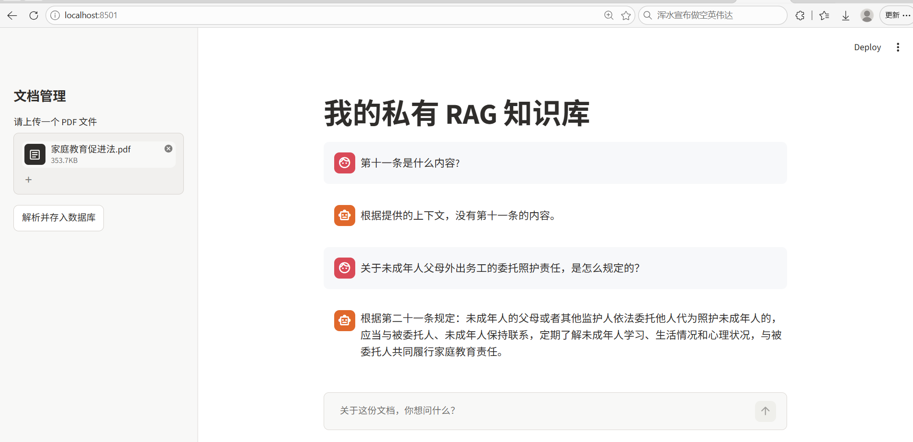

# My RAGLight Application

基于开源框架 RAGLight 进行二次开发的检索增强生成（RAG）应用。

## 项目亮点 (二次开发)
1. **Web 可视化界面**：基于 Streamlit 构建前端页面，支持上传 PDF 并实现类似 ChatGPT 的流式问答。
2. **混合架构设计**：由于国内大模型 API 兼容性限制，将原生 Embedding 替换为本地开源的 `BAAI/bge-small-zh-v1.5` 模型，实现离线向量化。
3. **云端推理**：使用阿里云百炼（通义千问 qwen-plus）作为 LLM 进行最终生成。

## 快速开始
1. 安装依赖：`pip install -r requirements.txt`
2. 根目录新建 `.env` 文件，填入 `MY_API_KEY=你的百炼API_KEY`。
3. 运行程序：`streamlit run app.py`

## 已知问题与技术演进 (Known Issues)
在测试中发现，系统对长篇自然语言问答效果极佳，但在处理“精确条款编号”（如“第十一条”）时存在召回失败现象。
* **原因分析**：经排查，PDF解析时存在文本断行问题；且纯向量检索（BGE模型）对无实际语义的数字缺乏敏感度。
* **后续计划**：计划引入 BM25 算法进行字面关键词召回，构建 **混合检索 (Hybrid Search)** 链路，以解决精确匹配难题。